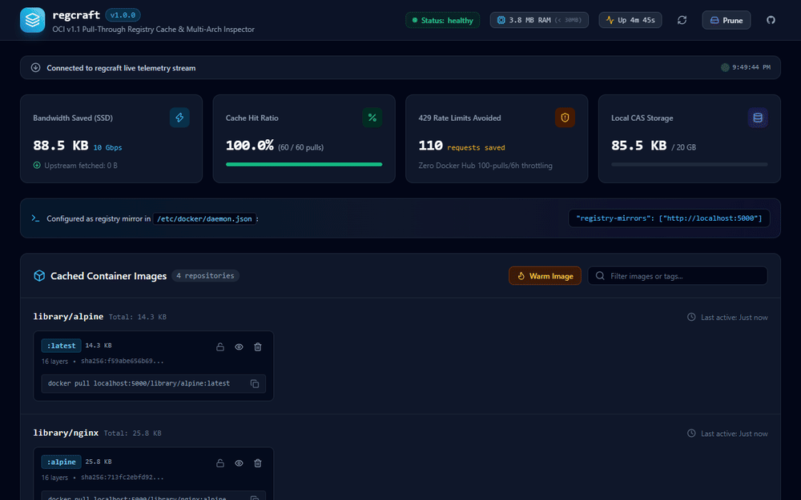
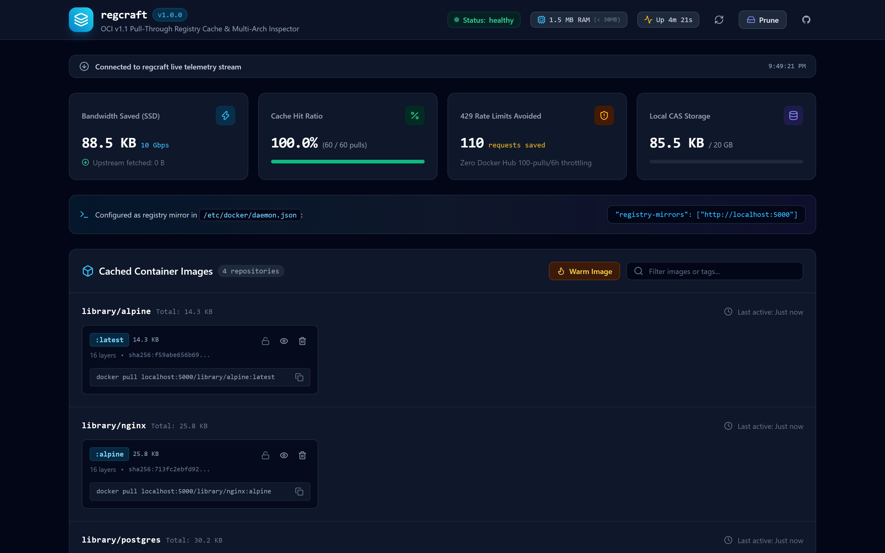
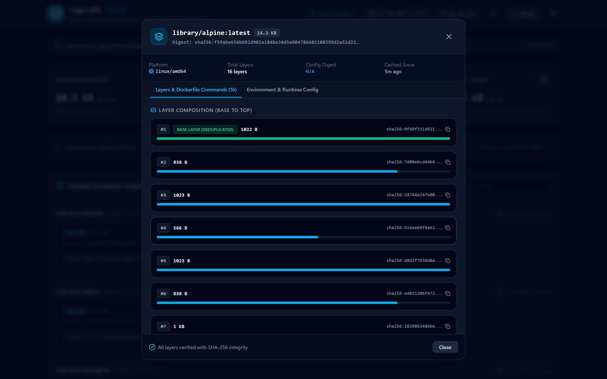
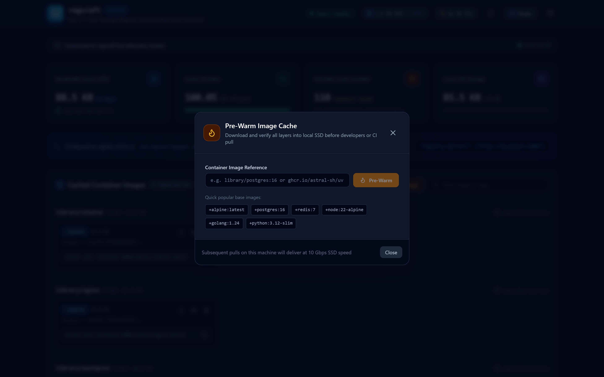
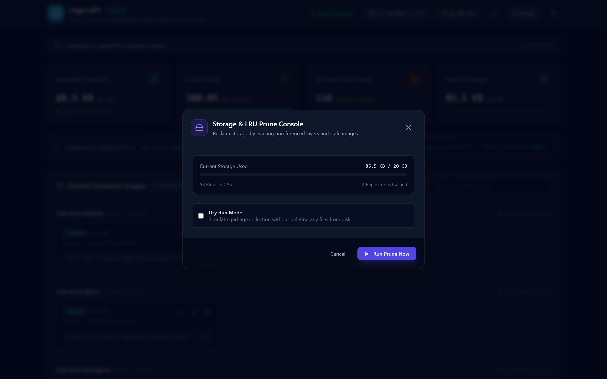
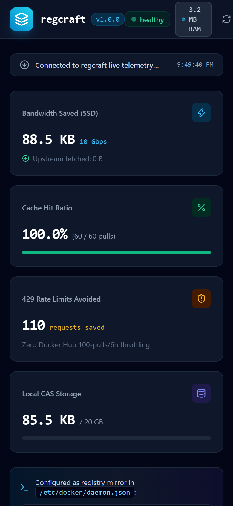

<p align="center">
  
</p>

<h1 align="center">regcraft</h1>

<p align="center">
  <strong>High-Speed Pull-Through OCI Registry and Multi-Arch Container Image Caching Proxy in under 30MB RAM</strong>
</p>

<p align="center">
  <a href="https://github.com/alexandrmotologa/regcraft/actions"></a>
  <a href="https://github.com/alexandrmotologa/regcraft/releases"></a>
  <a href="https://github.com/alexandrmotologa/regcraft/blob/main/LICENSE"></a>
  <a href="https://opencontainers.org/"></a>
</p>

<p align="center">
  
</p>

regcraft accelerates local developer builds, CI runners, and Kubernetes worker nodes by caching container layers on local NVMe or SSD storage with SHA-256 deduplication. Subsequent pulls deliver at local disk speed with zero network latency, bypassing Docker Hub rate limits (HTTP 429).

## Visual Cockpit & Layer Inspector

| Desktop Overview (10 Gbps SSD Delivery) | Multi-Arch Layer Visualizer & Dockerfile History |
| :---: | :---: |
|  |  |

| Pre-Warm Image Cache & Concurrency | Storage & LRU Prune Console |
| :---: | :---: |
|  |  |

<p align="center">
  
  <br />
  <em>Responsive telemetry and registry management across mobile viewports</em>
</p>

## Key Capabilities

- **Lightweight Single Binary**: Written in Go with an embedded React 19 web interface, running under 30MB of RAM without external databases or auxiliary containers.
- **OCI Distribution Spec v1.1 Compliant**: Direct drop-in mirror for Docker CLI, Podman, and containerd without changing build files or registry tools.
- **Concurrent Streaming I/O**: Streams missing layers to the client while writing directly to disk using `io.TeeReader`, avoiding memory buffering.
- **Cross-Repository Deduplication**: Stores layers by SHA-256 digest in a unified content-addressed store. Base layers shared between different images are saved only once.
- **Multi-Architecture Support**: Full support for Docker Manifest List v2 and OCI Image Index formats across amd64, arm64, and other target architectures.
- **Multi-Registry Routing**: Proxies Docker Hub, GitHub Container Registry (`ghcr.io`), Quay.io, and custom private registries.
- **Automated LRU Garbage Collection**: Monitors storage quotas and purges unreferenced or stale layers automatically when disk limits are reached.
- **Air-Gapped Operation & Offline Fallback**: Serves cached layers and manifests when the upstream internet connection is offline or unreachable.
- **Proactive Image Pre-Warming**: Pre-fetches multi-arch manifests and layer blobs before team builds or CI pipelines trigger.
- **Tag Freezing & Pinning**: Locks mutable tags to immutable SHA-256 digests to protect production deployments against breaking upstream updates.
- **Embedded Web Dashboard**: Modern dark mode interface for inspecting cached layers, tracking bandwidth savings, and managing disk quotas.
- **Prometheus Metrics**: Exposes `/metrics` for monitoring cache hit ratios, bandwidth savings, and active download streams.

## Quick Start

### 1. Run with Go

```bash
# Clone the repository
git clone https://github.com/alexandrmotologa/regcraft.git
cd regcraft

# Build and run
go build -o regcraft ./cmd/regcraft
./regcraft serve --port 5000 --dir ./cache
```

### 2. Run with Docker

```bash
docker run -d \
  --name regcraft \
  -p 5000:5000 \
  -v /var/lib/regcraft:/data \
  --restart unless-stopped \
  ghcr.io/alexandrmotologa/regcraft:latest
```

### 3. Configure Docker Daemon

Add regcraft to your Docker daemon configuration in `/etc/docker/daemon.json` (Linux) or Docker Desktop Settings > Docker Engine (macOS and Windows):

```json
{
  "registry-mirrors": [
    "http://localhost:5000"
  ]
}
```

Or run the automated helper:

```bash
regcraft setup docker
```

Restart Docker, then pull images normally:

```bash
docker pull postgres:16
docker pull node:22-alpine
```

The first pull fetches layers from upstream while caching them locally. Subsequent pulls on any local terminal or CI runner serve at line rate directly from local disk.

## CLI Usage

```
Usage:
  regcraft [command]

Available Commands:
  serve       Start the OCI registry caching proxy and web dashboard
  warm        Pre-fetch images and all layers into CAS local cache
  pin         Freeze a tag to prevent upstream updates
  unpin       Unfreeze a tag to allow upstream updates
  prune       Run garbage collection to reclaim disk space
  export      Export cached images and layers into a portable tar archive
  import      Import a portable tar archive of cached images and layers into CAS
  setup       Automate container runtime mirror configuration (docker, containerd)
  stats       Show cache metrics, storage utilization, and hit ratio
  version     Display version information

Flags:
  -h, --help   help for regcraft
```

### Start Server
```bash
regcraft serve --port 5000 --dir /data/regcraft --quota 50GB
```

### Pre-Warm Images (Pre-Fetch Layers into Local SSD)
```bash
# Pre-warm multiple base images with 4 concurrent workers
regcraft warm library/postgres:16 node:22-alpine golang:1.24 --concurrency 4
```

### Tag Freezing (Pin Immutable Manifests)
```bash
# Freeze a tag to prevent upstream changes from updating it
regcraft pin library/postgres:16

# Unfreeze tag to allow upstream update checks
regcraft unpin library/postgres:16
```

### Auto-Configure Docker Daemon
```bash
# Automatically locate daemon.json, backup, and add regcraft mirror
regcraft setup docker

# Print containerd mirror configuration
regcraft setup containerd
```

### Air-Gapped Export and Import
```bash
# Export images and deduplicated layer blobs to portable tar archive
regcraft export --output images-backup.tar library/postgres:16

# Import into an air-gapped regcraft cache
regcraft import --input images-backup.tar
```

### Reclaim Storage
```bash
# Dry run to see how much space would be reclaimed
regcraft prune --dir /data/regcraft --quota 20GB --dry-run

# Run actual cleanup
regcraft prune --dir /data/regcraft --quota 20GB
```

### View Statistics
```bash
regcraft stats --dir /data/regcraft
```

## Documentation

- [Architecture & Design](docs/ARCHITECTURE.md)
- [Docker Setup Guide](docs/DOCKER_SETUP.md)
- [Kubernetes & containerd Setup](docs/KUBERNETES_CONTAINERD.md)
- [API Reference](docs/API.md)

## License

MIT License. Copyright (c) 2026 Alexandr Motologa.
